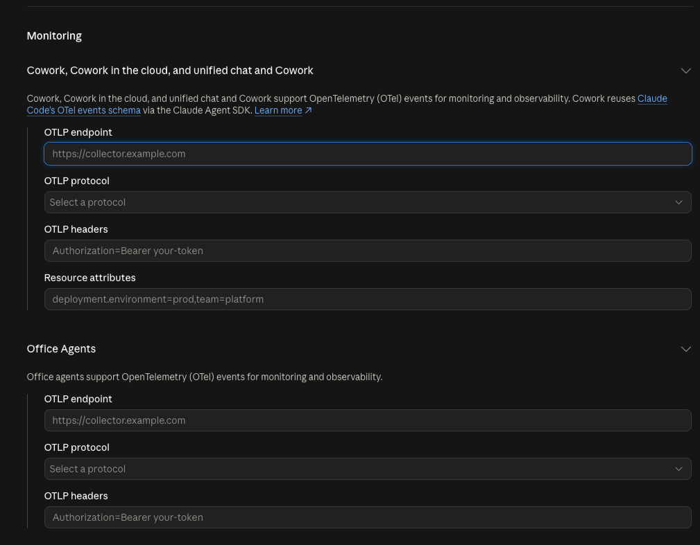
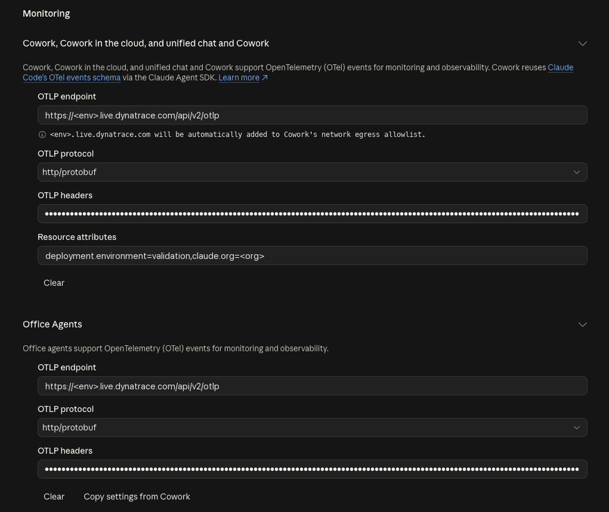
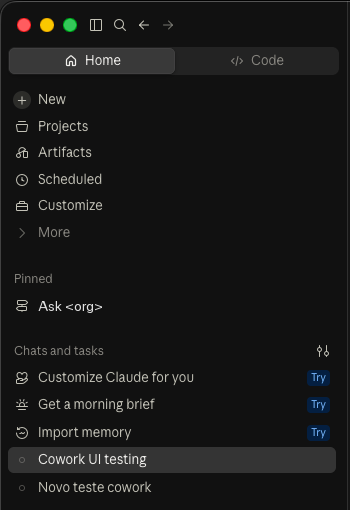
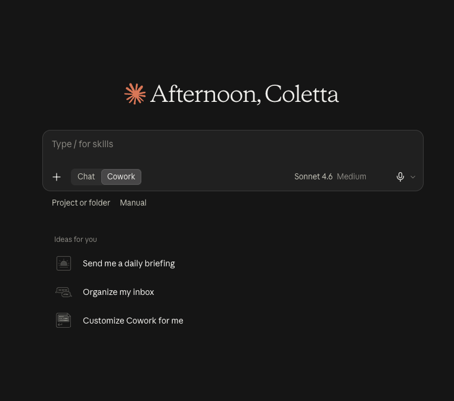
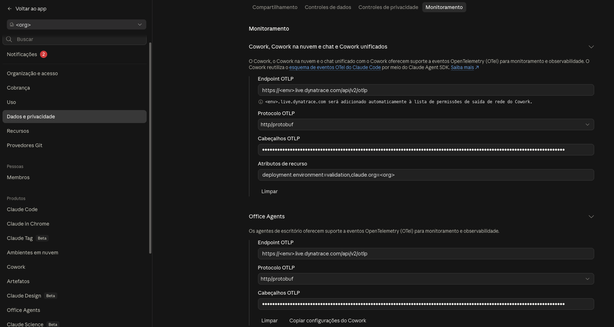
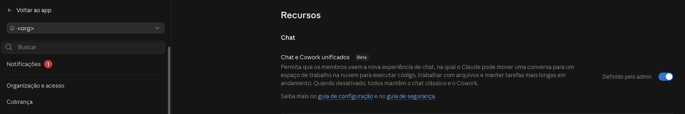
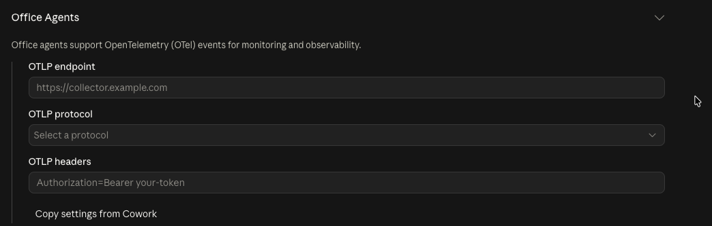

# Dynatrace AI Observability for Claude — Guia de Implantação

**Claude Desktop (aba Code) · Claude Code CLI → OpenTelemetry → Dynatrace**
Versão 1.0.1 · Dynatrace Solutions Engineering LATAM

---

## As três camadas

| Camada | Fonte | O que responde | Onde fica |
|---|---|---|---|
| 1 · Hooks | eventos de hook do Claude Code → spans `gen_ai.*` | o que aconteceu em cada conversa e tool call, em tempo real; prompts opcionais | esta pasta (`install.sh`) |
| 2 · OTel nativo | métricas e eventos de log do próprio Claude Code; eventos OTel do Cowork configurados pelo admin | tokens e custo por chamada de API, sessões, linhas de código, commits; sessões do Cowork | esta pasta (`--enable-native-otel`); Cowork: console admin do claude.ai, ver [Telemetria do Cowork](#telemetria-do-cowork) |
| 3 · Oficial | Anthropic Enterprise Analytics API, Console Admin API, CSV do Team | o que a Anthropic cobra por usuário e produto na org inteira, incl. chat do claude.ai, Cowork, Design, Claude Code na web | [`connector/`](connector/README.md) |

Diagramas: [visão geral](docs/overview.svg) · [coleta de dados](connector/docs/data-collection-architecture.svg) · [processo de instalação](connector/docs/installation-process.svg).

> A camada 3 (connector) está documentada **em inglês** em [`connector/README.md`](connector/README.md), [`connector/schema.md`](connector/schema.md) e na skill [`connector/skills/deploy-claude-usage-connector/SKILL.md`](connector/skills/deploy-claude-usage-connector/SKILL.md); o resumo em português está no diagrama de visão geral e na seção "Ordem de instalação" abaixo.

## O que é medido onde

| Por onde o dev usa o Claude | Tempo real na máquina (camadas 1 + 2) | Oficial da Anthropic (camada 3) |
|---|---|---|
| **Claude Desktop, aba Code** | ✅ conversas, tool calls, tokens, custo por chamada, prompts (opcional) | ✅ como `claude_code` (org Enterprise ou Console) |
| **`claude` CLI no terminal** | ✅ idem (`service.name = claude-code`) | ✅ como `claude_code` |
| **VS Code / Cursor** | ✅ mesmo hook (este instalador ou o asset VS Code) | ✅ como `claude_code` |
| **Claude Code na web** (nuvem da Anthropic) | ⚠️ só métricas/logs nativos, se o ambiente cloud tiver as variáveis `OTEL_*` (endpoint = `https://<tenant>.live.dynatrace.com/api/v2/otlp`, token em `OTEL_EXPORTER_OTLP_HEADERS`, `http/protobuf`; sem coletor local, logo sem redação nem `user.email`) | ✅ como `claude_code` (remoto) |
| **Cowork** (sessões locais do Desktop e sessões na nuvem a partir do desktop, web ou mobile) | ✅ exportação OTel configurada pelo admin, Team e Enterprise (**validado em 2026-10-20** pelo claude.ai web e pelo app Desktop): logs com `service.name = cowork`, `api_request` com modelo, tokens, custo e e-mail do usuário, mesmo esquema da camada 2; sem hooks, logo sem spans `gen_ai`. Ver [Telemetria do Cowork](#telemetria-do-cowork) | ✅ como `cowork` (Enterprise por uso); CSV do Team: **só excedente** |
| **claude.ai chat, Design** (web e chat do Desktop) | ❌ sem hooks, sem OTel. ⚠️ com o *Chat and Cowork unified* ligado (toggle beta no Team e no Enterprise): as conversas que usam o espaço de trabalho na nuvem (código, arquivos) chegam pela exportação OTel do Cowork; perguntas simples não (**validado no Team em 2026-10-20**) | ✅ como `chat` / `design` (Enterprise por uso). Team e Enterprise por assento: CSV de gastos com **só o excedente** (gasto acima da cota do assento; vazio se o uso extra estiver desligado), ou seja, visão parcial, não o consumo total |
| **Assinatura pessoal Pro / Max** | ✅ em máquina instrumentada | ❌ a Anthropic não expõe API para planos pessoais |
| **Claude via Bedrock, Vertex, Foundry** | ✅ os hooks funcionam para Claude Code | ❌ usar o billing da nuvem |

Regra prática: as camadas 1 + 2 respondem *o que está acontecendo agora e como* nas máquinas instrumentadas; a camada 3 responde *o que a Anthropic cobra da organização inteira*, incluindo produtos sem hook e quem não instalou nada. A query [`connector/dql/official-vs-observed-tokens.dql`](connector/dql/official-vs-observed-tokens.dql) cruza as duas.

### Respostas rápidas

- **Preciso de uma chave da Anthropic?** Só para a camada 3. As camadas 1 + 2 usam um token de ingest do Dynatrace e o login normal do Claude.
- **O workflow é só para o claude.ai?** Não. Ele importa o uso oficial da org inteira: Claude Code (Desktop, CLI, web) mais chat, Cowork e Design quando a org é Enterprise; Claude Code e uso de API quando é org do Console.
- **Funciona para Cowork?** Sim, de duas formas. Tempo real: o admin do claude.ai liga a exportação OpenTelemetry do próprio Cowork (Team e Enterprise) e aponta para o endpoint de logs do Dynatrace ou para um collector alcançável; os eventos chegam como `event.name == "api_request"` com tokens, custo e `user.email`, igual à camada 2 (ver [Telemetria do Cowork](#telemetria-do-cowork)). Oficial: camada 3 como produto `cowork` em Enterprise por uso. Cowork não tem hooks, então não há spans `gen_ai` nem input/output de tool calls.
- **E o chat do claude.ai no plano Team?** Nenhuma fonte dá tokens totais por usuário: não há API (confirmado na doc da Anthropic e por fornecedores de FinOps como a Finout) e o CSV de gastos lista **só o excedente** acima da cota do assento. O gap fecha ligando o *Chat and Cowork unified* (toggle beta, já disponível no Team): as conversas passam a rodar como sessões Cowork e saem pela exportação OTel do Cowork com tokens e custo por usuário (validado em 2026-10-20). Ferramentas que "automatizam" o CSV do Team fazem isso com navegador headless na sessão de um Owner; este asset não entrega isso.
- **Por que vejo texto `<system-reminder>` nos prompts?** Não deveria mais: o hook remove os blocos que o app Desktop injeta. Spans antigos continuam com eles.
- **Uso o Desktop com assinatura pessoal. O que ganho?** Tudo das camadas 1 + 2 na sua máquina; nada da camada 3.
- **De quanto em quanto tempo a camada 3 roda?** Uma vez por dia, às 15:00 UTC (12:00 em Brasília), os três workflows; as camadas 1 + 2 são em tempo real. Rodar mais vezes não traz dado novo: a API Console só devolve buckets fechados, o dado Enterprise do dia D fica completo por volta das 13:30 UTC de D+1 e é revisado por ~7 dias (cada execução relê 10 dias e a revisão mais nova vence pelo `dedup.key`), e a cota de 60 req/min é da org inteira. Para ver o dia corrente antes disso, execute o workflow manualmente (`dtctl exec workflow <id> --wait`); para mudar o horário, edite o agendamento do workflow no tenant ou em `connector/workflow/build.py`.

## Planos da Anthropic × APIs: o que existe (verificado na documentação da Anthropic em 2026-10-19; linhas de Cowork OTel e CSV do Team reconferidas em 2026-10-20)

| Plano / organização Claude | API oficial de uso e custo | O que se obtém | Chave | Limitações |
|---|---|---|---|---|
| **Free, Pro, Max** (pessoal) | ❌ nenhuma | nada; só as camadas 1 + 2 em máquina instrumentada | — | a Anthropic não expõe dados por usuário de planos pessoais |
| **Team** | ❌ sem API; exportação manual do **CSV de gastos** (claude.ai → Settings → Analytics, só Owner ou Primary Owner). ✅ exportação OTel do Cowork (admin) | por usuário × produto × modelo: requests, tokens de prompt/completion, gasto líquido e bruto, **só o excedente** (gasto acima da cota do assento; sem relatório algum se o uso extra estiver desligado; a taxa fixa por assento nunca aparece); até 90 dias, atualização diária com 1 dia de atraso | — | visão parcial do chat; sem divisão de tokens de cache; alguém precisa exportar e rodar o importador. Claude Code e Cowork ficam cobertos por completo pelas camadas 1 + 2 e pela exportação OTel do Cowork |
| **Enterprise, por assento** | ⚠️ Analytics API: endpoints de engajamento sim; endpoints de custo/uso devolvem **créditos de uso**, não dólares. ✅ exportação OTel do Cowork (admin) | usuários ativos, sessões, projetos, skills, conectores; tokens por usuário | Analytics API key (só o primary owner) | custo não vem em USD; o CSV de gastos só reflete o gasto acima da cota de assentos; o toggle de analytics por membro não existe nesse plano |
| **Enterprise, por uso** | ✅ Analytics API: `user_cost_report`, `user_usage_report`, `cost_report`, `usage_report` | por usuário × produto (chat, claude_code, cowork, claude_design, …) × modelo, diário: tokens, requests, USD | Analytics API key (só o primary owner, escopo `read:analytics`) | dados desde 2026-01-01; disponíveis ~4 h após o uso, revisados até ~7 dias após o fim do mês; 60 req/min por org |
| **Org do Console / Claude Platform** (clientes de API) | ✅ Admin API: `usage_report/claude_code` (por usuário, diário), `usage_report/messages` (org/workspace, buckets de 1m a 1d), `cost_report` (org, diário) | Claude Code por usuário com modelo e custo estimado; tokens de API por workspace / chave / modelo; USD por workspace | Admin API key `sk-ant-admin01-…` (admin da org) | contas individuais (sem org) não têm Admin API; `messages` só devolve buckets fechados; Console na AWS não tem API de uso |
| **Claude via Bedrock / Vertex / Foundry** | ❌ fora de todas as APIs da Anthropic | — | — | usar o billing da nuvem; os hooks continuam capturando sessões de Claude Code |

Os tipos de chave não são intercambiáveis: uma Admin API key não chama a Analytics API do Enterprise e vice-versa. Uma organização que usa Claude Platform e Claude Enterprise precisa das duas chaves, e este asset roda um workflow por chave (`org_type = console` e `org_type = enterprise`).

## Credenciais necessárias

| Você quer | Dynatrace | Anthropic | Quem cria |
|---|---|---|---|
| Camadas 1 + 2: prompts, tokens, custo e tool calls do Claude Desktop / CLI nas máquinas instrumentadas | token de ingest (`openTelemetryTrace.ingest`, `metrics.ingest`, `logs.ingest`) | **nenhuma** — o Claude continua com o login normal | admin Dynatrace; cada dev cola uma vez no instalador |
| Camada 3, org Claude **Enterprise** (chat, Cowork, Design, Claude Code de todos) | contexto dtctl + credencial no vault | **Analytics API key** | primary owner da org, claude.ai → Organization settings → API |
| Camada 3, org Claude **Console / API** (Claude Code por usuário, API por workspace) | idem | **Admin API key** `sk-ant-admin01-…` | admin da org, platform.claude.com/settings/admin-keys |
| Camada 3, plano **Team** | token com `bizevents.ingest` para o importador CSV | nenhuma — exportação manual do CSV (só excedente) | **Owner ou Primary Owner** do Team (Admin não exporta), claude.ai → Settings → Analytics |
| Eventos do Cowork em tempo real (Team e Enterprise) | token com `logs.ingest` (ou um collector que a nuvem alcance) | nenhuma — configuração no console admin | admin da org no claude.ai, Organization settings → Cowork → Monitoring |
| Dynatrace Evals (opcional) | platform token (`dt-evals doctor`) | uma API key comum para o LLM juiz (ou outro provedor) | quem roda os evals |

A chave da Anthropic é guardada uma vez no Credential vault do tenant e lida pelo workflow pelo nome; nunca chega às máquinas dos desenvolvedores.

### Ordem de instalação / quem faz o quê

1. **Admin Dynatrace, uma vez**: instala o app AI & LLM Observability pelo Hub, cria o token de ingest (`openTelemetryTrace.ingest`, `metrics.ingest`, `logs.ingest`), confere que o grupo IAM dos devs lê o bucket `default_logs` (ver [Troubleshooting](#troubleshooting)) e importa o `Dashboard/Developers AI Usage.json` (Dashboards → Upload).
2. **Cada desenvolvedor**: roda `./install.sh` (ou `.\install.ps1`) com o token, reabre as sessões do Claude Code e executa a DQL de health check de [docs/dql-examples.md](docs/dql-examples.md#health-check-is-data-arriving).
3. **Opcional, admin, uma vez — camada 3**: o primary owner / admin da org Claude cria a Analytics ou Admin API key → o admin Dynatrace guarda a chave no Credential vault (nome `Anthropic <org_type> usage API key`) → `connector/deploy/deploy.sh --org-type enterprise|console --org-id <rótulo> --run-now --yes` (allowlist, vault, workflow, primeira execução) → importa `connector/dashboard/claude-usage-dashboard.upload.json` (Dashboards → Upload, ou `dtctl apply -f connector/dashboard/claude-usage-dashboard.json`). Plano Team: roda o importador CSV em vez do workflow.
4. **Só plano Team, admin do Team, diário ou semanal**: exporta o CSV de gastos no claude.ai e roda `connector/csv-import/import-team-csv.sh <arquivo>` (um comando: dia padrão = ontem UTC, prévia, confirmação, envio via dtctl com o próprio login ou token `bizevents.ingest` guardado no cofre do SO). Desenvolvedores não mexem nisso. O Claude também faz: skill `connector/skills/import-team-csv`.

## Visão geral

Este asset leva a telemetria do Claude Code (tokens, custo, modelo, duração e tool calls por desenvolvedor) para o Dynatrace **sem precisar do VS Code**. Ele reaproveita o hook Python, a configuração do OTel Collector e o dashboard do asset [dt-ai-observability-vscode](https://github.com/Dynatrace-Internal/field-asset-library/tree/main/integrations/application/dt-ai-observability-vscode), mas instala tudo como um serviço de usuário (launchd, systemd --user ou Tarefa Agendada) com o token guardado no cofre de credenciais do sistema operacional.

```
Claude Desktop (aba Code) ─┐ hooks PreToolUse / PostToolUse /
claude (CLI)              ─┤ UserPromptSubmit / Stop → ~/.claude/otel-hook.py
                           │       │ spans OTLP/JSON (gen_ai.*)
                           │       ▼
                           │ otelcol-contrib · 127.0.0.1:4318 (serviço do usuário, ~50–80 MB RAM, ~200 MB em disco)
                           │       │ remove conteúdo de prompts · adiciona user.email, squad, cost_center
Telemetria nativa ─────────┘       │ (métricas + logs, opcional, via managed settings)
                                   ▼
                            HTTPS → https://<tenant>.live.dynatrace.com/api/v2/otlp
```

| Sessão iniciada em | `service.name` dos spans do hook | `service.name` das métricas/logs nativos |
|---|---|---|
| Claude Desktop, aba Code | `claude-code-desktop` | `claude-code-desktop` (Claude Code ≥ 2.42, verificado com o Desktop 2.42304; builds antigos: `claude-code`) |
| `claude` no terminal | `claude-code` | `claude-code` |

> O próprio Claude Code define o `service.name` da telemetria nativa; nos builds atuais o Desktop já aparece como `claude-code-desktop`. O `terminal.type` não ajuda (é `non-interactive` tanto no Desktop quanto em `claude -p`). Use `in(service.name, {"claude-code", "claude-code-desktop"})` nas queries; para builds antigos, o [docs/dql-examples.md](docs/dql-examples.md) mostra o join com os spans do hook pelo id da sessão.

---

## Pré-requisitos

### Dynatrace

| Item | Requisito |
|---|---|
| Tenant | SaaS com Grail. Use o host `.live.dynatrace.com` para OTLP, nunca `.apps.` |
| App | AI & LLM Observability (Hub) — para o Prompts stream / visões de AI Obs |
| Token | Escopos `openTelemetryTrace.ingest` + `metrics.ingest` + `logs.ingest` (o último só para a telemetria nativa) |

Gerar token: `Ctrl+K → Access Tokens → Generate new token`.

### Máquina do desenvolvedor

| Recurso | Requisito |
|---|---|
| SO | macOS 10.15+ (Intel / Apple Silicon), Linux x64 / arm64, Windows 10 1803+ / 11 |
| Python | 3.6+ no `PATH` (`python3` no macOS/Linux, `python` no Windows) — o hook é Python puro, sem dependências |
| Ferramentas | `curl` + `tar` (macOS/Linux); `tar.exe` e PowerShell 5.1+ (Windows) |
| Claude | Claude Desktop com a aba Code e/ou Claude Code CLI; os hooks são configurados no nível do usuário (`~/.claude/settings.json`) |
| Rede (uma vez) | `github.com` e `objects.githubusercontent.com` — download do binário `otelcol-contrib` (~100 MB) |
| Rede (sempre) | `<tenant>.live.dynatrace.com` na porta 443 |
| RAM / disco | ~50–80 MB de RAM para o coletor; ~200 MB livres em disco |

---

## Instalação

### macOS / Linux

```bash
./install.sh
```

O script pergunta o endpoint (basta o id do tenant, ex.: `abc12345`), o token (digitação oculta), o e-mail e, opcionalmente, squad e centro de custo.

Instalação silenciosa (rollout por script):

```bash
DT_INGEST_TOKEN='dt0c01.XXXX' ./install.sh --endpoint abc12345 --email dev@empresa.com --squad plataforma --cost-center cc-1234 --non-interactive
```

### Windows (PowerShell)

```powershell
Set-ExecutionPolicy -Scope Process Bypass
.\install.ps1
```

```powershell
$env:DT_INGEST_TOKEN = 'dt0c01.XXXX'
.\install.ps1 -Endpoint abc12345 -Email dev@empresa.com -Squad plataforma -CostCenter cc-1234 -NonInteractive
```

### Opções úteis

| macOS/Linux | Windows | Efeito |
|---|---|---|
| `--capture-prompts` | `-CapturePrompts` | Envia o conteúdo de prompts e respostas (desligado por padrão) |
| `--enable-native-otel` | `-EnableNativeOtel` | Liga as métricas/logs nativos do Claude Code via bloco `env` no `settings.json` do usuário |
| `--enable-evals` | `-EnableEvals` | Confere Node.js ≥ 20 e imprime como rodar o Dynatrace Evals sobre os prompts capturados; não executa nada |
| `--attr chave=valor` | `-Attr chave=valor` | Atributos customizados adicionais |
| `--collector-port`, `--health-port` | `-CollectorPort`, `-HealthPort` | Portas (padrão 4318 / 13133; se ocupadas, a próxima livre é usada) |
| `--otelcol-version`, `--otelcol-tarball` | `-OtelcolVersion`, `-OtelcolTarball` | Fixar a versão do coletor / instalar a partir de um tarball local (ambiente sem internet) |
| `--non-interactive` | `-NonInteractive` | Nunca perguntar nada |

Rodar o instalador de novo é seguro: ele atualiza a configuração, mantém hooks existentes, substitui o token e reinicia o serviço.

**Depois de instalar, feche e reabra as sessões do Claude Code** (aba Code e CLI) para que os hooks sejam carregados.

### O que fica na máquina

| Caminho | Conteúdo |
|---|---|
| `~/.claude/otel-hook.py` | Hook (upstream v1.7.0 + dois patches pequenos, em [hooks/otel-hook.patch](hooks/otel-hook.patch): `service.name = claude-code-desktop` quando `CLAUDE_CODE_ENTRYPOINT=claude-desktop`, e limpeza do prompt — remove blocos `<system-reminder>` e desembrulha `<pasted_content>` — antes de gravar o texto) |
| `~/.claude/settings.json` | 4 entradas em `hooks` (mescladas, sem apagar hooks existentes; backup `.bak-<data>` a cada alteração); bloco `env` opcional |
| `~/.claude/otel-attrs.json` | `os.type`, atributos customizados, `_capture_prompts`, `_collector_port` |
| `~/.dt-ai-obs/` | binário do coletor, `otel-collector.yaml` renderizado (sem token), `config.env`, wrapper `run-collector.sh`/`.ps1`, `logs/collector.log` |
| Token | Keychain (macOS, item `dt-ai-obs-claude`), Secret Service via `secret-tool` (Linux) ou arquivo 0600 com aviso, DPAPI (Windows, `ingest-token.dpapi`) |
| Serviço | LaunchAgent `com.dynatrace.dt-ai-obs-claude` · unidade `dt-ai-obs-claude.service` (systemd --user) · Tarefa Agendada "Dynatrace AI Observability (Claude) collector" |

---

**Custo estimado no dashboard.** O dashboard *Developers AI Usage* calcula `cost_usd` dentro das queries, com a mesma fórmula do asset VS Code
(mantida idêntica de propósito, para os dois assets mostrarem os mesmos números): `tokens de entrada × preço de entrada + tokens de saída × preço
de saída`, com preços de tabela por família (`opus` 15/75, `sonnet` 3/15, `haiku` 0,80/4 USD por 1M tokens; outros nomes caem em 2/10). Como
`gen_ai.usage.input_tokens` inclui leituras de cache, que a Anthropic cobra a ~10 % do preço de entrada, a estimativa é um **teto** e pode ser
várias vezes a fatura em sessões de Claude Code com muito cache. Para custo real use `gen_ai.usage.cost_usd` no span (quando o Claude Code
informa), `claude_code.cost.usage` / `cost_usd` dos eventos nativos `api_request` (camada 2) ou o `cost_usd` oficial de `claude.usage.daily`
(camada 3).

## Validação

### 1. Processo local

```bash
# macOS / Linux
curl http://127.0.0.1:13133
# Windows (PowerShell)
Invoke-WebRequest http://127.0.0.1:13133
# Esperado: {"status":"Server available","upSince":"...","uptime":"..."}
```

```bash
python3 hooks/configure-hooks.py status     # hooks, env nativo, otel-attrs.json
tail -f ~/.dt-ai-obs/logs/collector.log     # erros de export; uma linha "Traces"/"Metrics"/"Logs" por lote só com --verbose-collector
```

### 2. Spans chegando no Dynatrace

Abra **Notebooks** no tenant e execute (1–2 min após a primeira mensagem no Claude):

```dql
fetch spans, from:now()-15m
| filter in(service.name, {"claude-code", "claude-code-desktop"})
| summarize spans = count(), clientes = collectDistinct(service.name),
            modelos = collectDistinct(gen_ai.request.model), devs = collectDistinct(user.email)
```

Se `spans > 0`, a pipeline está completa. Importe então o dashboard `Dashboard/Developers AI Usage.json` (Dashboards → Upload).

### 3. Queries úteis

**Uso por desenvolvedor e cliente (Desktop × CLI):**
```dql
fetch spans, from:now()-24h
| filter in(service.name, {"claude-code", "claude-code-desktop"})
| filter startsWith(span.name, "chat")
| summarize requests = count(),
            tokens_in = sum(toLong(gen_ai.usage.input_tokens)),
            tokens_out = sum(toLong(gen_ai.usage.output_tokens)),
            by:{user.email, service.name}
| sort tokens_in desc
```

**Custo por chamada de API (telemetria nativa), por dev e modelo:**
```dql
fetch logs, from:now()-24h
| filter in(service.name, {"claude-code", "claude-code-desktop"}) and event.name == "api_request"
| summarize requests = count(), custo_usd = sum(toDouble(cost_usd)),
            tokens_in = sum(toLong(input_tokens)), tokens_out = sum(toLong(output_tokens)),
            by:{user.email, model}
| sort custo_usd desc
```

Mais exemplos (custo por squad/centro de custo, tool calls, erros de API, métricas, join Desktop × nativo) em [docs/dql-examples.md](docs/dql-examples.md).

---

## Telemetria nativa do Claude Code (opcional)

O Claude Code exporta métricas (`claude_code.token.usage`, `claude_code.cost.usage`, sessões, linhas de código, commits, PRs) e eventos de log (`api_request`, `api_error`, `user_prompt`, `tool_result`, `tool_decision`) quando algumas variáveis de ambiente estão definidas. O coletor deste asset já tem pipelines de `metrics` e `logs` apontando para `/api/v2/otlp/v1/metrics` e `/v1/logs`.

- **Por usuário**: `install.sh --enable-native-otel` (ou `-EnableNativeOtel`) grava o bloco `env` no `~/.claude/settings.json`.
- **Para a frota**: copie [managed-settings.example.json](managed-settings.example.json) para o caminho de managed settings, que o usuário não consegue sobrescrever:

| SO | Caminho |
|---|---|
| macOS | `/Library/Application Support/ClaudeCode/managed-settings.json` |
| Linux | `/etc/claude-code/managed-settings.json` |
| Windows | `C:\ProgramData\ClaudeCode\managed-settings.json` |

Os valores importantes: `OTEL_EXPORTER_OTLP_PROTOCOL=http/protobuf` e `OTEL_EXPORTER_OTLP_METRICS_TEMPORALITY_PREFERENCE=delta` (o Dynatrace só aceita delta; o processador `cumulative_to_delta` do coletor é apenas rede de segurança) e `OTEL_EXPORTER_OTLP_ENDPOINT=http://127.0.0.1:4318` (o coletor local — o token nunca entra na configuração do Claude).

Detalhes: o `service.name` nativo é definido pelo Claude Code (`claude-code-desktop` no Desktop a partir do build 2.42, `claude-code` no CLI e em builds antigos); o corpo do log (`content` no Grail) é `claude_code.<evento>`, ex.: `claude_code.api_request`, e os registros entram pelo pipeline `logs:default` no bucket `default_logs`; o e-mail da conta Anthropic vai para `claude.account_email` e o `user.email` informado na instalação é gravado em todos os sinais como atributo de *recurso* — e, desde a 1.0.1, o coletor também copia `user.email`, `deployment.environment` e os atributos customizados (`squad`, `cost_center`, `--attr …`) para cada datapoint das métricas nativas (`transform/metric_dimensions`), porque o Dynatrace só transforma atributos de *recurso* em dimensões quando estão na allow-list do tenant — na 1.0.0 `timeseries … by: {user.email}` em `claude_code.*` devolvia `null`. Agora a divisão por desenvolvedor/squad funciona direto nas métricas, além dos spans do hook e dos eventos de log `api_request`. `OTEL_LOG_USER_PROMPTS` fica em `0` e, mesmo que alguém ligue, o coletor apaga o campo `prompt` enquanto a captura de prompts estiver desligada.

---

<a id="configuracao-recomendada"></a>
## Configuração recomendada, status de cobertura e fontes da verdade (2026-10-20)

**Configuração que cobre todos os cenários sem contar em dobro**

| Onde | O que ligar |
|---|---|
| Org no claude.ai (Team ou Enterprise) | **Monitoramento** do Cowork direto para o Dynatrace ([Telemetria do Cowork](#telemetria-do-cowork)); **Chat e Cowork unificados** ligado (Recursos → Chat) |
| Máquina de cada dev | este asset com OTel nativo (`./install.sh --enable-native-otel`). Quem usa VS Code / Cursor instala **ou** a extensão do VS Code **ou** este asset, nunca os dois |
| Dynatrace | os dois dashboards; camada 3 com o importador do CSV (Team) ou o workflow da Analytics API (Enterprise por uso) |

**Uma fonte da verdade por pergunta**

| Pergunta | Fonte | Por que não duplica |
|---|---|---|
| Tokens e custo por usuário, em tempo real | logs `event.name == "api_request"` com `service.name` em `claude-code`, `claude-code-desktop`, `cowork` | um evento por chamada ao modelo, mesmo esquema para Claude Code, Cowork e chat unificado |
| O que aconteceu na conversa (ferramentas, duração, prompts) | spans do hook (`chat …`, `claude.tool.*`) | usar só para comportamento — nunca somar tokens dos spans com os dos logs, são os mesmos tokens |
| O que foi cobrado de fato | camada 3 (CSV do Team / Analytics API do Enterprise) | oficial e diário — comparar com o tempo real, nunca somar |

Regras: spans do hook e OTel nativo medem o mesmo uso do Claude Code (o total vem dos logs); uma instalação por máquina (extensão e asset gravam o mesmo hook, o último sobrescreve); o chat unificado já chega como `cowork`; o CSV do Team é só o excedente cobrado, um recorte do mesmo uso; o Cowork roda numa VM isolada e nunca passa pelo hook.

**Status de cobertura**

| Status | Superfícies |
|---|---|
| ✅ Validado de ponta a ponta num tenant | Claude Code na aba Code do Desktop e no CLI (spans do hook + `api_request` nativo); Claude Code no VS Code / Cursor (asset VS Code); Cowork pelo claude.ai web e pelo app Desktop; chat unificado que usa o espaço de trabalho na nuvem (código, arquivos); os dois dashboards com dados reais |
| 📄 Documentado pela Anthropic, ainda não validado aqui | CSV de gastos do Team com exportação real; Analytics API do Enterprise com dados reais (testada com mock); OTel do Office Agents (configurado, sem tráfego); Claude Desktop em modo terceiros (3P); Claude Code na web e Claude no Slack (abaixo) |
| ❌ Não existe telemetria | chat simples de pergunta e resposta (web e Desktop, qualquer modo) — só o excedente no CSV do Team ou a Analytics API do Enterprise (diária); Claude Design e Claude in Chrome — só Analytics API ou CSV |

Ressalvas: o custo do OTel é estimativa a preço de lista da API, não a fatura; no Team e no Enterprise por assento, o uso dentro da cota do assento não tem custo por token (é a mensalidade fixa); prompts e respostas ficam desligados por padrão em todas as fontes.

**Opções para pegar também o chat simples (documentadas, não validadas)**

- **Claude Enterprise por uso** — a Analytics API traz tokens e custo do chat por usuário por dia; a camada 3 deste asset já importa.
- **Claude Desktop em modo terceiros (3P)** — o Desktop envia toda a inferência para um provedor escolhido (Claude API, Bedrock, Vertex, Foundry ou um gateway) e, com `otlpEndpoint` (+ `otlpHeadersHelper` para o token), exporta logs e métricas das sessões de **Chat, Cowork e Code** com contagem de tokens e `enduser.id`. Contrapartidas: a cobrança passa de assento para token, o claude.ai web fica de fora (só Desktop), as conversas ficam no dispositivo, as novidades chegam depois. Teste em uma máquina: Help → Troubleshooting → Enable Developer Mode → Developer → Configure Third-Party Inference. Fontes: [visão geral 3P](https://claude.com/docs/third-party/claude-desktop/overview), [telemetria 3P](https://claude.com/docs/third-party/claude-desktop/telemetry).
- **Claude apps gateway** — gateway hospedado pela empresa na frente do Claude Code e do Desktop 3P, que mede gasto por desenvolvedor, aplica limites e repassa o OTel com `user.email` e grupos do IdP (`telemetry.forward_to`). Fonte: [configuração do gateway](https://code.claude.com/docs/en/claude-apps-gateway-config).

**Outras superfícies (documentadas, não validadas)**

- **Claude Code na web** — definir as chaves `CLAUDE_CODE_ENABLE_TELEMETRY` / `OTEL_*` nas **server-managed settings** da org (central, sem instalar nada por máquina; a credencial do collector vai ali, não em variáveis de ambiente).
- **Claude no Slack (Claude Tag)** — não recebe server-managed settings; definir as variáveis no ambiente de nuvem compartilhado da org e liberar o host do collector na allowlist de rede; as sessões trazem `app.entrypoint = claude-in-slack` com `OTEL_METRICS_INCLUDE_ENTRYPOINT=true`. Fonte: [Monitoring](https://code.claude.com/docs/en/monitoring-usage).

---

<a id="telemetria-do-cowork"></a>
## Telemetria do Cowork (Team e Enterprise, sem instalar nada na máquina)

As sessões do Cowork (locais no app Desktop e na nuvem a partir do desktop, web ou mobile) não passam pelo hook do Claude Code, mas a Anthropic exporta os eventos delas por OpenTelemetry quando um admin do claude.ai configura um endpoint OTLP. Nada sai até isso ser feito. Fonte: [Monitor Claude Cowork activity with OpenTelemetry](https://support.claude.com/en/articles/14477985-monitor-claude-cowork-activity-with-opentelemetry).

**Validado em 2026-10-20** com uma org Claude Team apontando para um tenant Dynatrace SaaS: sessões do claude.ai web (chat e Cowork unificados) e tarefas Cowork iniciadas no app Claude Desktop com uma pasta local chegaram como registros de log com tokens, custo, modelo e e-mail do usuário. Roteiro passo a passo com as queries em [`docs/dql/`](docs/dql/): [docs/cowork-validation.md](docs/cowork-validation.md).

| Item | Valor |
|---|---|
| Planos | Team e Enterprise (validado no Team) |
| Onde | claude.ai → Organization settings → Data and privacy → **Monitoring** → *Cowork, Cowork in the cloud, and unified chat and Cowork* (Owner / admin). Link direto: `claude.ai/admin-settings/data-privacy-controls#cowork-monitoring` |
| OTLP endpoint | `https://<env>.live.dynatrace.com/api/v2/otlp` — a URL **base**, sem `/v1/logs` (o exportador acrescenta; validado). Use `.live.`, não `.apps.`. O host entra sozinho na allowlist de rede do Cowork |
| OTLP protocol | **http/protobuf** (o endpoint OTLP do Dynatrace rejeita JSON) |
| OTLP headers | `Authorization=Api-Token dt0c01.<público>.<secreto>` — formato `chave=valor`, como no exemplo do campo; token clássico com **Ingest logs** (`logs.ingest`). Cole o token logo depois de `Api-Token ` e confira que começa com um único `dt0c01.` (prefixo duplicado dá 401 e nada chega, sem erro nenhum no console) |
| Resource attributes | opcional, ex.: `deployment.environment=validation,claude.org=<org>`; chegam como atributos do log e ajudam a filtrar |
| Sinal | **só logs** (`/api/v2/otlp/v1/logs`); sem spans e sem métricas |
| `service.name` | `cowork` (escopo `com.anthropic.claude_code.events`, `service.version` = versão do Claude Agent SDK) |
| Onde a sessão rodou | `cowork.surface`. `remote` = o agente rodou na nuvem da Anthropic. Numa org Team isso inclui tarefas Cowork iniciadas **no app Desktop com uma pasta local**: o Desktop cria uma sessão na nuvem e compartilha a pasta com ela (validado em 2026-10-20, Desktop 2.42304.2). Uma tarefa rodando inteira na VM local do Desktop não foi observada nessa configuração |
| Eventos vistos | `api_request`, `user_prompt`, `assistant_response`, `tool_decision`, `tool_result`, `mcp_server_connection`, `plugin_loaded`, `hook_*`, `managed_settings_resolved`, `permission_mode_changed` — mesmos nomes e campos da telemetria nativa do Claude Code (camada 2) |
| Campos do `api_request` | `model`, `input_tokens`, `output_tokens`, `cache_read_tokens`, `cache_creation_tokens` (+ `_5m` / `_1h`), `cost_usd`, `cost_usd_micros`, `duration_ms`, `ttft_ms`, `effort`, `speed`, `query_source`, `session.id`, `prompt.id`, `request_id` |
| Identidade | `user.email`, `user.account_uuid`, `user.id`, `organization.id` sempre presentes |
| Conteúdo | `prompt` chega como `<REDACTED>` (só `prompt_length`) por padrão; ligar conteúdo exige a device policy `otlpContentCapture` (defina `[]` para manter desligado em builds antigos do Desktop) |
| Desktop mínimo | 1.1.4173 para sessões locais, 1.22209.3 para sessões na nuvem |

```dql
fetch logs, from:now()-24h
| filter service.name == "cowork" and event.name == "api_request"
| summarize requests = count(),
            input = sum(toLong(input_tokens)), output = sum(toLong(output_tokens)),
            cache_read = sum(toLong(cache_read_tokens)), cache_creation = sum(toLong(cache_creation_tokens)),
            custo_usd = sum(toDouble(cost_usd)),
  by: {user.email, model, cowork.surface}
| sort custo_usd desc
```

**O que é exportado depende do modo de chat da org** (validado em 2026-10-20 numa org Team):

| Configuração da org *Chat and Cowork unified* | Cowork (web e Desktop) | Chat (web e Desktop) |
|---|---|---|
| **Desligado** — seletor clássico Chat \| Cowork | ✅ exporta (validado pelo app Desktop com pasta local) | ❌ não exporta |
| **Ligado** (beta) — uma Home só, sem Cowork separado | ✅ exporta (validado pelo claude.ai web) | ⚠️ **só as conversas que passam para o espaço de trabalho na nuvem** (execução de código, arquivos ou pastas anexados, tarefas mais longas) são exportadas, como `service.name = cowork` — validado pelo claude.ai web e pelo app Desktop. Uma pergunta simples, sem espaço de trabalho, continua chat clássico e **não** é exportada, nem a criação de arquivo do próprio chat ("Created a file") quando o Claude não move a conversa para o espaço de trabalho — quem decide é o Claude, não o usuário (testado em 2026-10-20) |

**Recomendação:** para ver o máximo possível (Claude Code + Cowork + chat que usa o espaço de trabalho) por desenvolvedor, ligue o **Chat and Cowork unified** (Organization settings → Recursos (Capabilities) → Chat). Antes de fazer isso num cliente, avise que é beta, que os usuários perdem o seletor Chat/Cowork e as conversas passam a rodar na nuvem da Anthropic, e que o time de segurança pode precisar revisar execução de código e acesso a arquivos na nuvem (a Anthropic linka um guia de segurança no próprio toggle). Deixe *Acesso antecipado: Execute o Cowork na nuvem* como está; é outra configuração e ficou desligada durante a validação.

Telas (host do tenant e nome da org mascarados):

| Organization settings → Data and privacy → Monitoring, vazio | Configurado |
|---|---|
|  |  |

| Desktop, unificado **ligado** (Home, sem aba Cowork) | Desktop, unificado **desligado** (seletor Chat \| Cowork) |
|---|---|
|  |  |

Na interface em português: Monitoramento fica em **Dados e privacidade**, e o toggle do modo unificado em **Recursos → Chat**:





Bloco do Office Agents com *Copy settings from Cowork*: 

**No dashboard:** a seção *Cowork e chat unificado* do *Developers AI Usage* é alimentada por esses eventos assim que chegam (validado no tenant de laboratório: custo, requests, devs ativos, tokens, tokens por modelo e top devs com `cowork.surface`).

Observações:

- **Dashboards.** O *Developers AI Usage* tem a seção **Cowork e chat unificado** (custo, requests, devs ativos, tokens, tokens ao longo do tempo por modelo e top devs com `cowork.surface`), lida desses logs; os outros tiles leem spans `gen_ai`, que o Cowork não manda, e as variáveis Provider/Modelo não se aplicam à seção do Cowork. As queries de log da camada 2 em [docs/dql-examples.md](docs/dql-examples.md) aceitam `cowork` ao lado de `claude-code` / `claude-code-desktop`, e os tiles de cobertura da camada 3 comparam `claude_code` e `cowork` por produto.
- **Chat unificado conta como Cowork.** Com o *Chat and Cowork unified* (toggle beta, disponível no Team e no Enterprise em Organization settings → Recursos (Capabilities) → Chat) as conversas que passam para o espaço de trabalho na nuvem (código, arquivos, tarefas mais longas) rodam como sessões Cowork e saem por esta exportação; perguntas simples continuam chat clássico e não são exportadas, então o gap do chat diminui, mas não fecha. Validado: um chat comum no claude.ai web chegou como `service.name = cowork`, `cowork.surface = remote`.
- **Atraso.** Na primeira execução, as sessões na nuvem levaram vários minutos para aparecer no Grail; espere até ~20 minutos antes de investigar.
- **Onde fica o token.** Apontar o console admin direto para o Dynatrace coloca um token de ingest no console do claude.ai (cifrado em repouso pela Anthropic). Use um token dedicado, só com `logs.ingest`, para poder revogar isoladamente. Para redação ou fan-out, use um collector com endpoint HTTPS público; o collector local em `127.0.0.1:4318` deste asset não recebe sessões da nuvem.
- **Office Agents** (add-ins de Excel, PowerPoint e Word) têm um bloco próprio de Monitoring na mesma página, com o botão *Copy settings from Cowork*; ainda não validado.
- O Cowork também aparece na camada 3 como produto `cowork` (Enterprise por uso) e, como excedente, no CSV de gastos do Team.

---

## Dynatrace Evals (opcional)

O [dt-evals](https://github.com/dynatrace-oss/dt-evals) (`@dynatrace-oss/dt-evals`, open source, alpha) pega spans `gen_ai.*` de produção, pede a um LLM "juiz" que avalie cada interação e grava o veredito de volta na tenant como bizevents. Os spans deste asset servem direto: cada turno do Claude Code é um span `gen_ai.operation.name == "chat"` com `gen_ai.prompt.0.content` / `gen_ai.completion.0.content` **quando a captura de prompts está ligada**. O script [evals/run-evals.sh](evals/run-evals.sh) (`evals\run-evals.ps1` no Windows — mesmas opções, ainda não validado de ponta a ponta) faz o papel dos comandos *Configurar Evals* / *Rodar Evals* da extensão VS Code: mesma lista de evaluators, mesmas opções de janela (`--since`) e amostragem (`--sample`), configuração gerada para o formato dos spans deste asset e confirmação `y/N` antes de qualquer coisa que custe dinheiro. Nada roda sozinho; o instalador só imprime os passos (`--enable-evals`).

**O que é avaliado** — 15 métricas built-in, uma nota (0–1), um rótulo `pass`/`fail` e uma explicação por turno amostrado:

| Grupo | Evaluators | Lê |
|---|---|---|
| Segurança (padrão) | `prompt-injection`, `pii-leakage` | prompt; prompt + resposta |
| Segurança (mais) | `output-prompt-injection`, `toxicity`, `bias` | resposta |
| Fundamentação | `hallucination`, `faithfulness`, `factual-accuracy` | prompt + resposta |
| Qualidade | `relevance`, `answer-completeness`, `conciseness`, `fluency`, `summarization-quality`, `context-relevance` | prompt + resposta |
| Experiência | `user-frustration` | prompt |

O par padrão responde às duas perguntas que um time de plataforma realmente tem sobre assistentes de código: *alguém está mandando payload de prompt injection para o Claude Code (issue colada, README, saída de ferramenta) e há dado pessoal nos prompts ou respostas?* As métricas de fundamentação e qualidade foram pensadas para RAG e chat; funcionam em turnos de código (`--metrics all`), mas leia as notas com esse contexto.

**Pré-requisitos**

- Captura de prompts **ligada** (`install.sh --capture-prompts`). Sem isso o script se recusa a rodar: os spans não têm texto. O hook corta cada atributo em 4 096 caracteres, então o juiz vê os primeiros 4 KB de cada prompt e de cada resposta.
- Node.js ≥ 20 (o CLI roda via `npx`, nada é instalado globalmente).
- Um **platform token** (`dt0s16…`) com `storage:spans:read`, `storage:buckets:read`, `storage:bizevents:read`, `openpipeline:bizevents:ingest` (`storage:events:write` se a URL for `*.apps.dynatrace.com`) e `storage:logs:read` (usado pelo `validate`); `storage:metrics:write` é opcional. `run-evals.sh doctor` guia a criação em `myaccount.dynatrace.com` e guarda o token como `DT_API_TOKEN` em `evals/.env` (ignorado pelo git). Um API token clássico (`dt0c01…`) com escopos equivalentes também funciona. O usuário do token precisa ler o bucket `default_spans`.
- A chave do provedor juiz: `ANTHROPIC_API_KEY` (padrão; modelo `claude-sonnet-4-6` salvo `--model`) ou `OPENAI_API_KEY` com `--provider openai`. Azure OpenAI, Gemini, Vertex e Bedrock também são aceitos.

**Custo e dados**

- Cada execução real chama o juiz uma vez por turno amostrado **por evaluator**: `turnos na janela × --sample % × evaluators`. Cada chamada manda até ~8 KB de prompt/resposta mais o prompt do evaluator para a **sua** conta no provedor de LLM. Com os padrões (última hora, 10 %, dois evaluators) um dia de uso custa centavos; `--metrics all --sample 100 --since 24h` numa frota, não.
- O dt-evals mascara e-mails, telefones, cartões e SSN em memória antes de chamar o juiz. O resto dos 4 KB vai como está. Esse é o único caminho em que texto de prompt capturado sai da tenant: é o mesmo texto que o coletor já envia ao Dynatrace quando a captura está ligada.
- Os resultados ficam na **mesma tenant** de onde vieram os spans; o texto avaliado **não** é copiado para os bizevents de resultado, a menos que se passe `--store-evaluated-prompt`.
- Comece com `preview` (busca os spans amostrados, não chama o juiz, não grava nada) para ver quantos turnos entram, mantenha a amostra e os evaluators padrão na primeira execução e só então aumente.

**Comandos**

```bash
evals/run-evals.sh plan                                  # config gerada + comando exato; sem rede
evals/run-evals.sh doctor                                # checa dtctl e guia o platform token → evals/.env
export ANTHROPIC_API_KEY=...                             # ou OPENAI_API_KEY e --provider openai
evals/run-evals.sh validate                              # schema, conectividade com a tenant, juiz alcançável
evals/run-evals.sh preview --since 6h --sample 25        # o que seria julgado; só lê spans
evals/run-evals.sh run --since 6h --sample 25 --metrics prompt-injection,pii-leakage,toxicity   # pergunta y/N e roda
evals/run-evals.sh runs                                  # histórico local (~/.dt-eval/runs.json)
```

Opções: `--since 30m|1h|6h|24h` (padrão `1h`), `--sample 10|25|50|100` (padrão `10`), `--metrics a,b,c|all` (padrão `prompt-injection,pii-leakage`; vários rodam numa passada via config gerada), `--provider`/`--model`, `--service claude-code|claude-code-desktop|both`, `--env-url` (padrão: derivada de `~/.dt-ai-obs/config.env`), `--store-evaluated-prompt`, `--config` (usar um `.dt-eval.yaml` próprio), `--concurrency N` (chamadas paralelas ao juiz; padrão do dt-evals 5), `--allow-no-capture` (roda mesmo com a captura desligada — nada a avaliar, serve para testar a pipeline), `--dry-run`, `--yes`. A config gerada (`evals/.dt-eval.yaml`, sem segredos) restringe o escopo a `operationNames: [chat]`, `service.name` em `{claude-code, claude-code-desktop}` e mapeia `spanFields` para `gen_ai.prompt.0.content` / `gen_ai.completion.0.content`.

**Lendo os resultados** — bizevents com `event.type == "gen_ai.evaluation.result"`, um por turno × evaluator: `gen_ai.evaluation.name`, `gen_ai.evaluation.score.value` (0–1), `gen_ai.evaluation.score.label` (`pass`/`fail`), `gen_ai.evaluation.explanation`, `dt.eval.run_id`, `trace_id`/`span_id` (o turno do Claude Code), `gen_ai.request.model` (modelo **juiz**), `gen_ai.evaluation.input.request_model` (modelo Claude que respondeu).

```dql
fetch bizevents, from:now()-7d
| filter event.type == "gen_ai.evaluation.result"
| summarize turnos = countDistinct(trace_id), nota_media = avg(gen_ai.evaluation.score.value),
            falhas = countIf(gen_ai.evaluation.score.label == "fail"), by: { gen_ai.evaluation.name }
| sort falhas desc
```

Para ver por desenvolvedor/squad, faça join com os spans do hook por `trace_id` (query pronta em [docs/dql-examples.md](docs/dql-examples.md#evaluation-results-dt-evals-optional)). Sugestão de tiles no *Developers AI Usage* depois da primeira execução: *single value* de falhas de `pii-leakage` em 7 d (verde 0, amarelo ≥ 1, vermelho ≥ 5), *barras* de vereditos por evaluator e *tabela* das últimas 20 falhas com desenvolvedor, squad e explicação. O JSON do dashboard não foi alterado.

---

## Atributos customizados

`--squad`, `--cost-center` e `--attr chave=valor` viram atributos de recurso em todos os sinais (via coletor), atributos de span nos spans do hook (via `otel-attrs.json`) e, desde a 1.0.1, dimensões das métricas nativas. `--squad` grava o mesmo valor também como `user.team`, a chave pela qual o dashboard *Developers AI Usage* (deste asset e do asset VS Code) agrupa em "Custo por time" / "Uso por time"; assim as máquinas instrumentadas por qualquer um dos dois assets caem nas mesmas tiles, no mesmo tenant. No dashboard do asset VS Code, selecione uma vez `anthropic` e os modelos Claude nas variáveis `Provider` / `Modelo` (os padrões dele são outros provedores). Chaves começando com `_` são reservadas (`_capture_prompts`, `_collector_port`). Para alterar, rode o instalador de novo com os novos valores.

---

## Troubleshooting

| Sintoma | Causa provável | Correção |
|---|---|---|
| `curl 127.0.0.1:13133` falha | Serviço parado | macOS: `launchctl print gui/$(id -u)/com.dynatrace.dt-ai-obs-claude`; Linux: `systemctl --user status dt-ai-obs-claude`; Windows: histórico da Tarefa Agendada. Leia `~/.dt-ai-obs/logs/collector.log` |
| Instalador avisa que 4318/13133 estão ocupadas | Coletor da extensão VS Code (ou outro receiver) rodando | O hook segue a nova porta (`_collector_port`); ajuste `OTEL_EXPORTER_OTLP_ENDPOINT` para a telemetria nativa, ou pare o outro coletor e reinstale |
| `Exporting failed` / 401 / 403 no log | Escopos do token ou host `.apps.` | Reinstale com token correto e endpoint `.live.` |
| 401 no `collector.log` logo após instalar, com token novo e escopos certos | O prompt oculto (`read -s`) recebeu o token **duas vezes** ou com espaço (alguns terminais / gerenciadores de clipboard colam no Cmd-V *e* no Enter). Desde a 1.0.1 o instalador rejeita o que não for `dt0c01.<24>.<64>` e faz um POST vazio de pré-voo em `/v1/traces` (401/403 abortam), então isto vale para instalações feitas com a 1.0.0 | Confira o tamanho guardado — um token `dt0c01.` tem 96 caracteres (`dt0c01.` + 24 + `.` + 64): macOS `security find-generic-password -s dt-ai-obs-claude -w \| tr -d '\n' \| wc -c`; Linux `secret-tool lookup service dt-ai-obs-claude key ingest-token \| wc -c` ou `wc -c < ~/.dt-ai-obs/ingest-token`. Reinstale sem digitar: `DT_INGEST_TOKEN='dt0c01.…' ./install.sh --endpoint … --email … --non-interactive` |
| Dashboard com tiles vazios, mas `fetch spans` traz dados | A variável `Modelo` do *Developers AI Usage* tem uma lista padrão fixa de ids de modelo e todo tile filtra `in(gen_ai.request.model, $Modelo)`; se os spans trazem outro modelo (ex.: `claude-sonnet-4-5`) nada aparece até marcá-lo | Abra o filtro `Modelo` e marque seus modelos (a query da variável lista só os modelos vistos no período do dashboard). Idem para `Provider` se `gen_ai.system` mudar |
| 400 em `/v1/metrics` | Temporalidade cumulativa | Garanta `OTEL_EXPORTER_OTLP_METRICS_TEMPORALITY_PREFERENCE=delta` (managed settings vencem as do usuário) |
| Spans chegam, métricas/logs não | Telemetria nativa desligada ou sessão antiga | `python3 hooks/configure-hooks.py status`; reinicie o Claude Code |
| Spans **e** métricas chegam, o `collector.log` mostra lotes `Logs` com HTTP 200 e sem `partialSuccess`, mas `fetch logs` não acha nada (nem por `session.id` ou `content`) | **Permissão de leitura no Grail**, não ingestão: os logs OTLP entram pelo pipeline `logs:default` no bucket `default_logs`. Se a política IAM do usuário que consulta não tem `storage:buckets:read` nesse bucket, os registros são gravados mas ficam invisíveis para ele — a ingestão responde sucesso e nada na UI explica. (O formato do registro está correto: variantes de body, `event.name`, timestamp e número de atributos foram testadas) | 1. `fetch dt.system.buckets \| filter dt.system.table == "logs"` — a coluna *has access* de `default_logs` tem de ser `true`. 2. `fetch logs, from:now()-2h \| summarize count(), by:{dt.system.bucket, dt.openpipeline.pipelines}` mostra onde estão os logs que você consegue ler. 3. No tenant: em Account Management → Identity & access → Groups → seu grupo → Permissions, adicione a política built-in **Read Logs** (ou uma custom `ALLOW storage:buckets:read WHERE storage:bucket-name = "default_logs";`) com escopo no ambiente e sem boundary. Se *has access* continuar `false` mesmo assim, procure uma instrução **`DENY storage:buckets:read WHERE storage:bucket-name = "default_logs"`** em alguma política ligada a um dos grupos do usuário (ex.: grupo de "acesso restrito a logs"): um DENY vence qualquer ALLOW, e a única correção é tirar o usuário desse grupo ou remover a instrução. **Ou** crie em OpenPipeline → Logs uma regra de roteamento `matchesValue(service.name, "claude-code*")` para um pipeline cujo estágio de storage grava num bucket legível (ex.: `claude_code_logs`). Reverifique com [docs/dql-examples.md](docs/dql-examples.md#native-logs-health-check) |
| Nenhum span | Python ausente ou sessões abertas antes da instalação | `python3 --version`; reinicie o Claude Code; teste `echo '{"hook_event_name":"Stop","session_id":"x"}' \| python3 ~/.claude/otel-hook.py; echo $?` (deve ser 0) |
| `user.email` vazio | Instalado sem `--email` | Reinstale com `--email` |
| Texto de prompt visível no Dynatrace | Instalado com `--capture-prompts` | Reinstale sem a flag (o coletor volta a redigir) |
| macOS: o Keychain pede senha quando o serviço sobe | Item criado por outra ferramenta | `security delete-generic-password -s dt-ai-obs-claude` e reinstale (o CLI `security` precisa ser o criador do item) |
| Linux: `secret-tool` funciona no terminal mas o serviço não lê o token | Sem sessão D-Bus para o `systemd --user` | Reinstale numa sessão gráfica ou passe para o fallback de arquivo à mão. O instalador não tem flag para isso: ele escolhe o backend sozinho (Keychain no macOS → `secret-tool` → arquivo `~/.dt-ai-obs/ingest-token` modo 0600 quando nenhum keyring responde). Para forçar o arquivo: `umask 077; printf '%s' "$TOKEN" > ~/.dt-ai-obs/ingest-token; chmod 0600 ~/.dt-ai-obs/ingest-token`, ajuste `TOKEN_BACKEND=file` em `~/.dt-ai-obs/config.env` e rode `systemctl --user restart dt-ai-obs-claude` |
| Spans do Desktop aparecem como `claude-code` | A extensão VS Code sobrescreveu `~/.claude/otel-hook.py` | Reinstale (os dois gravam o mesmo arquivo; o último vence). O dashboard funciona dos dois jeitos |
| Camada 3: o workflow termina bem mas `events: 0` para hoje | `usage_report/messages` só devolve buckets fechados (hoje = buckets de 1 h, visíveis quando a hora fecha); `usage_report/claude_code` é agregado diário com ~1 h de atraso | Espere a próxima execução ou rode `dtctl exec workflow <id>` mais tarde; ver [connector/README.md § Freshness and caveats](connector/README.md#freshness-and-caveats) (EN) |
| Camada 3: log da task mostra `HTTP 401` de `api.anthropic.com` | Tipo de chave errado para a org (Admin key em org Enterprise ou vice-versa) ou chave revogada | Crie a chave que o tipo de org exige e atualize a credencial no vault; ver [connector/README.md § Which organization type needs which key](connector/README.md#which-organization-type-needs-which-key) (EN) |

---

## Desinstalação

Rode o desinstalador a partir da pasta do asset (a mesma de onde instalou):

```bash
./uninstall.sh          # --yes pula a confirmação; --keep-hooks / --keep-binary mantêm partes
```

```powershell
.\uninstall.ps1         # -Yes, -KeepHooks, -KeepBinary
```

Tudo o que o instalador criou é removido; nada mais em `~/.claude/settings.json` é alterado:

| O quê | Onde | macOS | Linux | Windows |
|---|---|---|---|---|
| Serviço do collector (parado antes) | serviço do usuário | LaunchAgent `com.dynatrace.dt-ai-obs-claude` | unidade `systemctl --user` `dt-ai-obs-claude.service` | Tarefa Agendada *Dynatrace AI Observability (Claude) collector* |
| Token de ingest | cofre do SO | item do Keychain | entrada no `secret-tool` (ou o arquivo 0600) | arquivo cifrado com DPAPI |
| Entradas de hook do Claude Code | `~/.claude/settings.json` → `hooks` | as quatro entradas (`PreToolUse`, `PostToolUse`, `UserPromptSubmit`, `Stop`) que apontam para `otel-hook.py`; outros hooks ficam | idem | idem |
| Bloco `env` do OTel nativo (se usou `--enable-native-otel`) | `~/.claude/settings.json` → `env` | as chaves `CLAUDE_CODE_ENABLE_TELEMETRY` / `OTEL_*` que o asset adicionou | idem | idem |
| Script do hook, atributos, estado | `~/.claude/` | `otel-hook.py`, `otel-attrs.json`, `otel-state/` | idem | idem |
| Binário, config e logs do collector | `~/.dt-ai-obs/` | pasta inteira | idem | idem |

Opções:

| Flag (bash / PowerShell) | Quando usar |
|---|---|
| `--yes` / `-Yes` | remoção por script, sem pergunta de confirmação |
| `--keep-binary` / `-KeepBinary` | vai reinstalar depois: mantém `~/.dt-ai-obs/bin` e evita o download de ~100 MB do collector |
| `--keep-hooks` / `-KeepHooks` | quer que o hook continue emitindo para outro collector em `127.0.0.1:4318` (por exemplo o da extensão do VS Code); o hook nunca trava o Claude Code se ninguém estiver ouvindo |

Depois, **reinicie as sessões abertas do Claude Code** (terminal ou aba Code do Desktop): hooks e env são lidos na inicialização, então uma sessão em execução continua com os antigos até reiniciar.

Para confirmar que a máquina ficou limpa:

```bash
launchctl list | grep dt-ai-obs ; ls ~/.dt-ai-obs ~/.claude/otel-hook.py 2>&1 ; python3 -c "import json,os;s=json.load(open(os.path.expanduser('~/.claude/settings.json')));print(list((s.get('hooks') or {}).keys()), [k for k in (s.get('env') or {}) if k.startswith('OTEL')])"
```

Os quatro comandos devem indicar que não há nada instalado (`No such file`, `[] []`). No tenant nada é apagado: spans, métricas e logs já ingeridos ficam no Grail até a retenção do bucket expirar, e o dashboard continua funcionando sobre esse histórico.

> **Quem usa a extensão do VS Code / Cursor:** este asset e a extensão *Dynatrace AI Governance For Devs* gravam o mesmo `~/.claude/otel-hook.py` e as mesmas entradas de hook. Se os dois foram instalados, remova a extensão com `code --uninstall-extension DynatraceExtensionCommunity.dt-ai-observability` (ou o comando *Remove Claude Code Hooks* dela) **e** rode este desinstalador; o que rodar por último deixa a máquina limpa.

---

## Teste local sem tenant

`test/run-local-test.sh` instala apontando para um sink HTTP local (`test/sink.py`, porta 9999) com token fictício, dispara os quatro eventos de hook para uma sessão "Desktop" e uma "CLI", opcionalmente roda `claude -p` com telemetria nativa, verifica que nenhum texto de prompt chegou ao sink e, com `--uninstall`, desfaz tudo. O resultado da última execução está em `test/local-e2e.log`.

---

## Estrutura do projeto

```
dt-ai-observability-claude/
├── install.sh / uninstall.sh          macOS e Linux
├── install.ps1 / uninstall.ps1        Windows
├── hooks/
│   ├── otel-hook.py                   hook (upstream v1.7.0 + patches service.name e limpeza de prompt)
│   ├── otel-hook.patch                o diff aplicado
│   ├── upstream/otel-hook.py          cópia literal do HOOK_SCRIPT da extensão VS Code
│   └── configure-hooks.py             mescla/remove hooks, otel-attrs.json, env nativo
├── collector/
│   ├── otel-collector.yaml            template do coletor (traces + metrics + logs)
│   ├── render-config.py               renderiza o template para ~/.dt-ai-obs
│   ├── run-collector.sh / .ps1        wrapper do serviço (lê o token do cofre)
│   ├── com.dynatrace.dt-ai-obs-claude.plist
│   └── dt-ai-obs-claude.service
├── evals/
│   ├── run-evals.sh / .ps1            Dynatrace Evals (dt-evals) sobre os spans capturados
│   └── .dt-eval.yaml / .env           gerados pelo script (ignorados pelo git; .env guarda os tokens)
├── managed-settings.example.json      telemetria nativa do Claude Code para a frota
├── Dashboard/Developers AI Usage.json dashboard (versão só-Claude do dashboard do asset VS Code)
├── docs/dql-examples.md
├── test/                              sink + teste ponta a ponta
├── README.md · GUIDE.md · meta.yaml · LICENSE
└── connector/                         componente separado (conector de uso do Claude), README próprio
```

---

## Privacidade e segurança

- **Sem conteúdo de prompts por padrão** — o hook só envia conteúdo com `_capture_prompts: "true"`, e o coletor apaga `gen_ai.prompt*`, `gen_ai.completion*`, `gen_ai.input.messages`, `gen_ai.output.messages`, `gen_ai.system_instructions` e o campo `prompt` dos logs nativos antes de qualquer envio. Ficam apenas metadados (modelo, tokens, custo, nomes de ferramentas). Ligar a captura exige `install.sh --capture-prompts`: a flag grava `_capture_prompts: "true"` no `otel-attrs.json` **e** renderiza o coletor sem o processador `transform/redact_content`; editar só o JSON não basta.
- **Entrada e saída das tools só com captura ligada** — cada span `claude.tool.<nome>` carrega `claude.tool_input` e `claude.tool_response` (primeiros 4 KiB de cada: comandos de shell, caminhos e conteúdo de arquivos) **apenas quando `--capture-prompts` está ligado**; sem a flag o hook não os envia e o `transform/redact_content` do coletor os apaga como segunda barreira (desde 1.0.1). O estado do hook em disco (`~/.claude/otel-state`, 0700/0600) também só guarda esses textos com a captura ligada.
- **Evals são opt-in e nunca automáticos** — o [Dynatrace Evals](#dynatrace-evals-opcional) só funciona com a captura ligada, pergunta antes de cada execução paga e é o único caminho em que texto de prompt (mascarado) sai da tenant: para o provedor de LLM juiz que você configurar. Os resultados voltam para a mesma tenant sem o texto avaliado, salvo `--store-evaluated-prompt`.
- **Sem override por workspace** — hooks e atributos ficam em arquivos do usuário; o `.claude/settings.json` de um repositório não muda o endpoint nem religa a captura de conteúdo. Managed settings (do admin) prevalecem sobre as do usuário para o env do OTel nativo.
- **Token fora de texto plano** — Keychain / Secret Service / DPAPI; o wrapper injeta o token como variável de ambiente apenas no processo do coletor. O YAML renderizado e o `config.env` (modo 0600) não contêm o token.
- **Somente loopback** — receivers OTLP e health check em `127.0.0.1`; saída apenas HTTPS para o tenant.
- **Binário verificável** — baixado de [open-telemetry/opentelemetry-collector-releases](https://github.com/open-telemetry/opentelemetry-collector-releases) com checagem SHA-256; versão fixável e instalação a partir de tarball local para ambientes isolados.
