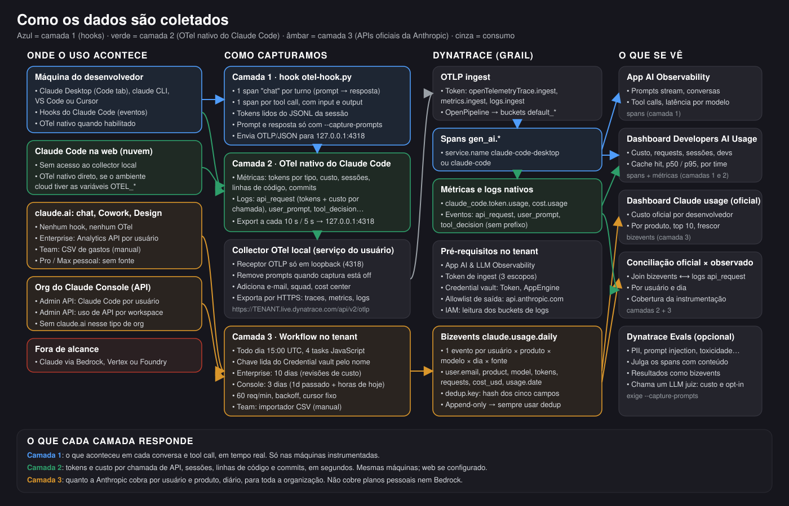
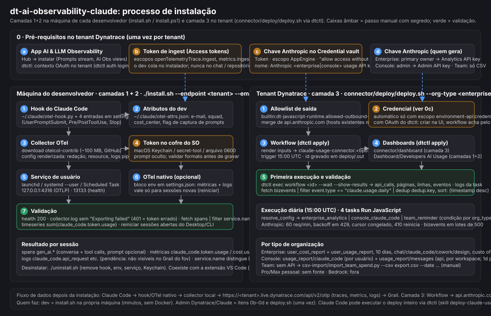

# Connector — layer 3: official daily Claude usage & cost per developer

Layers 1 and 2 of dt-ai-observability-claude see what happens on instrumented machines in real time (Claude Code hooks → spans,
Claude Code native OTel metrics/logs). They cannot see claude.ai chat, Cowork, Design, Claude Code on the web, or any
developer who did not install the hooks. **Layer 3 is the official, billing-grade source**: once a day it imports
Anthropic's own per-user usage and cost figures into Grail as business events (`event.type = "claude.usage.daily"`, one
event per user × product × model × UTC day × source). Prompts and content are never collected.

```
connector/
├── schema.md                      bizevent schema, product mapping, dedup rules
├── workflow/
│   ├── claude-usage-connector.json   importable workflow (generated — do not edit by hand)
│   ├── build.py                      tasks/ + lib/common.js  →  JSON + build/*.js
│   ├── lib/common.js                 shared: Anthropic client (rate limit, backoff, cursor rules), event builder, ingest batching
│   └── tasks/                        resolve_config · enterprise_analytics · console_claude_code · team_reminder
├── csv-import/                    import_team_spend.py (+ sample.csv) for Claude Team plans
├── dql/                           4 ready queries (cost/dev, tokens by product+model, top 10, official vs observed)
├── dashboard/                     claude-usage-dashboard.json (dtctl) · .upload.json (Dashboards app) · build.py
├── deploy/                        deploy.sh (dtctl, end to end) · vault_upsert.js · render_workflow.py · merge_allowlist.py
├── skills/deploy-claude-usage-connector/SKILL.md   Claude skill: deploy + operate with dtctl
└── test/                          mock_server.py (Anthropic + bizevents sink) · run_tests.sh · test.log · Node SDK shims
```

## Installation at a glance





Tenant prerequisites once (AI Obs app, ingest token, Anthropic key in the vault), then `install.sh` on each developer machine (layers 1+2)
and `deploy/deploy.sh` once per tenant (layer 3). Amber steps are the only manual ones and always involve a secret the operator pastes.
`deploy.sh` does four things — outbound allowlist, credential vault, workflow apply, optional run-now + verification DQL — and **does not
deploy dashboards**: both dashboards (`../Dashboard/Developers AI Usage.json` and `dashboard/claude-usage-dashboard.upload.json`) are
imported by hand with Dashboards → Upload or `dtctl apply -f` (see [Dashboard](#dashboard) below).

## Which organization type needs which key

| Your Claude org | `org_type` | Credential | Where to create it | API used | Per-user? |
|---|---|---|---|---|---|
| **Claude Enterprise** (claude.ai, usage-based plan) | `enterprise` | **Analytics API key** (scope `read:analytics`) | claude.ai → Organization settings → API. Only the **primary owner** can enable API access and create it. | `GET /v1/organizations/analytics/user_cost_report` and `user_usage_report` (`bucket_width=1d`, `group_by[]=product,model`, `limit=1000`) | yes — chat, claude_code, cowork, design, … |
| **Claude Console / Claude Platform** (API orgs) | `console` | **Admin API key** `sk-ant-admin01-…` | platform.claude.com/settings/admin-keys (organization admin) | `GET /v1/organizations/usage_report/claude_code` (per user/API key, per day) and optionally `usage_report/messages` grouped by model + workspace (org-level, `product=api`) | yes for Claude Code; API usage is org/workspace level |
| **Claude Team** | `team` | none | claude.ai → Settings → Analytics → **export spend CSV** (≤ 90 days, daily refresh, 1-day lag) | none — run `csv-import/import_team_spend.py` | yes (from the CSV) |

The two key types are not interchangeable: an Admin key cannot call the Enterprise Analytics API and vice-versa.
Seat-based Enterprise plans get usage credits only in the cost endpoints, not dollars.

## Setup

### 1. Credential vault
Create a **Token** credential (Settings → Credential vault → Add new credential) holding the Analytics or Admin key, named
`Anthropic enterprise usage API key` or `Anthropic console usage API key` (or any name you then pass as workflow input `credential_name`),
with Credential scope **AppEngine**, **Allow access without app context (Workflows)** ON and **Owner access only** ON (owner = workflow owner).
The workflow looks the entry up by name at run time, so no id is needed; `credential_id` still works if you prefer it.
Note the difference between the two paths: the UI path above uses *Owner access only* ON; `deploy.sh` (`vault_upsert.js`) creates or
updates the entry with owner-access-only **off** (shared with all AppEngine consumers), because the dtctl actor is usually not the workflow
owner. If you created the entry in the UI with owner-only ON and then run `deploy.sh` without `--skip-vault`, the update flips it to shared —
set it back in the UI if your policy requires it.

### 2. Outbound allowlist
Workflow tasks may only call allow-listed hosts. Add `api.anthropic.com` to
`builtin:dt-javascript-runtime.allowed-outbound-connections` (Settings → Preferences → Allowed outbound connections).
Relative `/platform/...` calls (bizevent ingest) need nothing.

### 3. Workflow
Import `workflow/claude-usage-connector.json` (Workflows app → Upload, or `dtctl apply -f workflow/claude-usage-connector.json` — note the
returned id and put it in the JSON as `id` for later updates; dtctl's `--write-id` does not write the file back)
and set the workflow **inputs**:

| Input | Meaning | Default | Run params may override? |
|---|---|---|---|
| `org_type` | `enterprise` \| `console` \| `team` — gates which task runs. **Required**: the run fails fast when it is missing from the input | `enterprise` | no |
| `credential_name` | vault entry name, used when `credential_id` is empty | `Anthropic <org_type> usage API key` | no |
| `credential_id` | vault entry id (`CREDENTIALS_VAULT-…`) with the Anthropic key | — (optional when the entry is named as above; not needed for team) | no |
| `org_id` | label copied to `org.id` | empty | no |
| `anthropic_base_url` | Anthropic API base URL — must be `https://api.anthropic.com` (any other host, scheme or look-alike is rejected) | `https://api.anthropic.com` | no |
| `allow_custom_base_url` | `true` lets `anthropic_base_url` point elsewhere. **Mocks only** (`test/run_tests.sh` uses it for the loopback server); never set it on a tenant — the key is sent to that URL | false | no |
| `enterprise_lookback_days` | re-read window (revisions), clamped 1–31 | 10 | yes |
| `console_lookback_days` | days re-read for Console, clamped 1–31 | 3 | yes |
| `console_include_api_usage` | also import org-level API usage as `product=api` | true | yes |
| `dry_run` | build events, log counts, ingest nothing | false | yes |
| `console_debug` | return the `usage_report/messages` bucket list the console task saw (no secrets) | false | yes |
| `ingest_batch_size` | events per ingest request, clamped 1–1000 (batches are also split at 4 MiB) | 500 | no |
| `time_budget_ms` | paging stops after this many ms (2000–95000); lower it only in tests | 95000 | no |

Run parameters (`dtctl exec workflow <id> --input '{…}'`, "Run with parameters") can only override the inputs marked **yes**;
anything else in the params — in particular `org_type`, `credential_*`, `anthropic_base_url` — is ignored and logged by `resolve_config`.
The workflow is imported **private** (`isPrivate: true`) and `deploy/vault_upsert.js` creates the vault entry with **Owner access only**.

**Partial runs.** Every Anthropic call is serialized at ≥ 1.1 s, so a large org (users × days × product × model rows, 1000 per page)
may not fit in one task. Each adapter stops paging at `time_budget_ms` (95 s of the 110 s task timeout) or after 200 pages per
report, flushes what it accumulated to bizevents when < 15 s are left and once at the end, and returns `partial: true` with a `reason`
in the task result (`dtctl logs workflow-execution …` shows the same line). Nothing is lost: the next scheduled run re-reads the whole
lookback window and the DQL `dedup dedup.key, sort: {timestamp desc}` keeps the newest record. A `Retry-After` longer than 20 s is
clamped to 20 s, and a back-off that would cross the deadline is not slept — the run ends partial instead. If `partial: true` shows up
every day, shorten `enterprise_lookback_days` / `console_lookback_days` or split org types across workflows.

Schedule: **daily 15:00 UTC**, the only trigger (no hourly or event trigger). Why once a day and why that hour: Enterprise data for day D is
normally complete by 13:00–13:30 UTC on D+1 and is revised for ~7 days (hence the 10-day re-read; the newest revision wins by `dedup.key`);
the Console `usage_report/messages` endpoint returns closed buckets only (today arrives through 1 h buckets); and the 60 req/min budget is
shared by the whole org. A manual run (`dtctl exec workflow <id> --wait --show-results`) is the way to see the current day earlier; the
time itself is `trigger.schedule.time` in `workflow/build.py` (or edit the workflow in the tenant).
The four tasks are `resolve_config` → (`enterprise_analytics` | `console_claude_code` | `team_reminder`), each gated by
`result("resolve_config").org_type`. Each task stays within the 120 s runtime limit: ≥ 1.1 s between Anthropic calls
(60 req/min org-wide budget, shared), backoff on 429/5xx honouring `Retry-After`, restart on 410 (expired cursor), ingest
in batches of `ingest_batch_size` events (500) and at most 4 MiB each via `businessEventsClient.ingest`.

Scripted alternative: `deploy/deploy.sh --org-type console --org-id acme --run-now --yes` does steps 1–3 with dtctl plus a first run
(see `skills/deploy-claude-usage-connector/SKILL.md`; the Anthropic key is read from the `ANTHROPIC_USAGE_KEY` env var and never written to disk).
With an OAuth dtctl context the vault step needs the `environment-api:credentials:*` scope that `dtctl auth login` does not request: create the
Token credential in the UI instead and pass `CREDENTIAL_ID=… --skip-vault`. `deploy/deploy_all.sh` runs the three org types in one go.

### 4. Team plan: CSV importer
```bash
export DT_INGEST_TOKEN=dt0c01....   # scope bizevents.ingest
python3 csv-import/import_team_spend.py --csv spend-export.csv --date 2026-10-18 --tenant https://abc12345.live.dynatrace.com --org-id acme
# --dry-run prints the payload instead of sending; --endpoint /platform/ingest/custom/events/<name> for an OpenPipeline endpoint
```
Columns mapped: `user email`→`user.email`, `account UUID`→`user.id`, `product`, `model`, `model family`, `total_requests`→`requests`,
`total_prompt_tokens`→`tokens.input`, `total_completion_tokens`→`tokens.output`, `total_net_spend_usd`→`cost_usd`,
`total_gross_spend_usd`→`cost.gross_usd`; `usage.date` = the `--date` you pass (the export period end). Rows with the same
user/product/model are summed. Cache tokens are not in the export (0).

## Querying

The layer 3 dashboard excludes rows with `org.id == "demo-sample"` (the fake rows `csv-import/sample.csv` produces); keep that filter if you load the sample into a shared tenant, since bizevents cannot be deleted.

Ingest is append-only and the connector re-reads recent days on purpose, so **every query dedupes**:
`| dedup dedup.key, sort: {timestamp desc}` (newest revision wins) and filters on `usage.date`, not `timestamp`.
See `dql/`:

| File | Question |
|---|---|
| `cost-per-developer-30d.dql` | cost, tokens, requests, active days per developer, last 30 days |
| `tokens-by-product-model.dql` | token mix (input/output/cache) and cost per product × model |
| `top10-developers-by-cost.dql` | top 10 developers with product split |
| `official-vs-observed-tokens.dql` | layer 3 official daily tokens (deduped, demo rows dropped, `product == "claude_code"` only) vs layer 2 real-time `event.name == "api_request"` logs from `service.name` `claude-code` / `claude-code-desktop`, per developer per day → coverage % and USD delta. Both sides use UTC days (`formatTimestamp(…, timezone: "UTC")`, matching `usage.date`) |

## Dashboard

`dashboard/claude-usage-dashboard.json` is a ready Dynatrace dashboard over the `claude.usage.daily` events (14 tiles: cost / developers /
tokens / latest usage day KPIs, daily cost by usage day stacked by product, top 10 developers split by product, cost per developer table,
tokens by product × model stacked by token type, official-vs-observed coverage KPI + table, freshness per source, caveats). Every data
tile applies the dedup rule above and filters on `usage.date`; charts over time use `toTimestamp(usage.timestamp)`. The two tables reuse
`dql/cost-per-developer-30d.dql` and `dql/official-vs-observed-tokens.dql` verbatim.

Import it either way:

* **Dashboards app** → *Upload* → pick `dashboard/claude-usage-dashboard.upload.json` (the content object the app expects).
* **dtctl** (needs a context with `document:dashboards:write`):
  ```bash
  dtctl apply -f connector/dashboard/claude-usage-dashboard.json          # creates the dashboard, prints id + URL
  dtctl apply -f connector/dashboard/claude-usage-dashboard.json --dry-run # validate only
  ```
  To update the deployed copy later, `dtctl get dashboard <id> -o json > dashboard.json`, edit that file (it carries the `id`) and apply it —
  re-applying the generated file creates a second dashboard.

Both files are generated by `python3 dashboard/build.py --check` (checks ids/layout overlaps, the dedup rule and `event.type` filter in every
query, and that every `recordField` / unit override names a query field). Edit `build.py`, not the JSON.

Things to know when reading it:

* The dashboard **time picker does not apply**: tiles fix their own window (last 30 usage days; coverage tiles last 7) because the bizevent
  `timestamp` is the ingest time. `fetch … from: now() - 45d` is deliberately wider than the window (ingest lags usage by 1–10 days).
* The coverage tiles join layer 2 logs on `event.name == "api_request"` and the attribute names in `dql/official-vs-observed-tokens.dql`;
  if layer 2 renames them, change the right side of that join (the table tile is read from the file at build time, the KPI is in `build.py`).
* Bedrock / Vertex / Foundry spend is not in any tile (not exposed by Anthropic — see below); Team-plan rows exist only after running the CSV importer.
* The queries were validated structurally only (no tenant was queried while building this). First import on a tenant: open each tile once;
  a blank tile with a DQL error is a syntax problem to fix in `build.py`, an empty tile with no error means no events in the window yet.

## Freshness and caveats

| Source | Lag | Revisions | Notes |
|---|---|---|---|
| Enterprise Analytics API | usually < 4 h, up to 24 h; engagement endpoints 1 day | cost/usage values can change until **~7 days after the end of the calendar month** | hence the 10-day re-read; `usage.complete` flags days ≤ `data_refreshed_at`; data exists from 2026-01-01 |
| Console Admin API | `usage_report/claude_code` is daily, typically within ~1 h. `usage_report/messages` returns **closed buckets only**: the connector reads past days with `bucket_width=1d` and today with `1h` buckets, so API usage shows up ~1 h after the request (verified on a real org) | today's rows grow during the day | 3-day re-read; `requests` not exposed; `product=api` rows have no cost (use `/v1/organizations/cost_report` if needed) |
| Team CSV | manual; export refreshed daily with a 1-day lag | re-export and re-import overwrite via dedup | no cache token columns |

* **Amazon Bedrock / Vertex / Foundry are not covered**: Claude usage through cloud marketplaces does not appear in any of these
  Anthropic endpoints (the Enterprise API explicitly excludes Bedrock Claude Code activity; Console on AWS has no usage API).
  Use the cloud provider's billing export for that.
* Cost figures are Anthropic's estimates/invoices at read time, in USD; amounts arrive as decimal strings in cents and are
  divided by 100 (6-decimal rounding — fine for dashboards, use the raw API for invoicing-grade reconciliation).
* Rate limit is per organization (60 req/min) and shared with any other consumer of the Analytics API.
* The bizevent `timestamp` is the ingest time; chart by `toTimestamp(usage.timestamp)`.

## Local test (no tenant, no real key)

```bash
./test/run_tests.sh        # starts test/mock_server.py on 127.0.0.1:8787, runs the 4 built tasks under Node for the 3 org types,
                           # runs the CSV importer (--dry-run and against the sink), checks dedup.key parity and schema → test/test.log
```
The Node shims in `test/mocks/node_modules/@dynatrace-sdk/*` implement exactly the SDK calls the tasks use
(`credentialVaultClient.getCredentialsDetails`, `businessEventsClient.ingest`, `execution`, `result`), so the scripts embedded in
the workflow JSON are the ones under test. The mock returns 429 on the first call to each endpoint and rejects cursors whose
query params changed, which exercises the backoff and the pagination contract.
